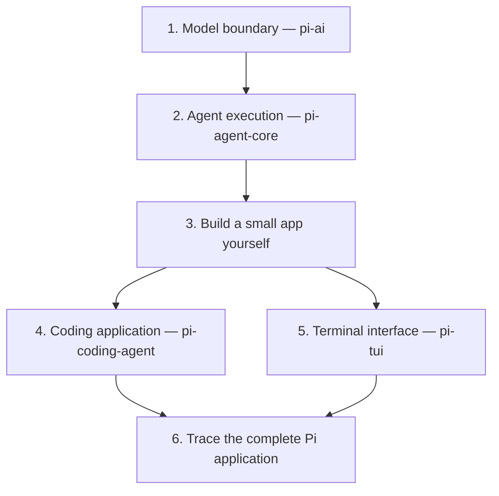

# Learning Pi — working curriculum

## Goal

Understand how Pi works well enough to appreciate its design, predict its behavior, locate the responsible code, and build applications using its underlying libraries.

This is a concept-led exploration, not a file-by-file tour or a checklist of six lessons. The headings below set direction; code walkthroughs and experiments determine depth.

**Priority:** go deep on `pi-ai` and `pi-agent-core`, build with them independently, then understand what `pi-coding-agent` and `pi-tui` add. The four packages do not need equal time.

## How we will learn

- Small guided exploration objectives in VS Code; the learner navigates and discovers, rather than receiving exact paths and answers every time.
- Explain the concept, inspect its real implementation, and exercise it where useful.
- Connect new mechanisms to the model, loop, state, tools, and events already understood.
- Check reasoning at meaningful boundaries, not API-name recall. An acknowledgment alone is not proof of understanding.
- Distinguish current implementation from the November 2025 article. Do not force current code to match the article.
- Distinguish documented design rationale from inferred rationale. Code establishes behavior; docs, history, issues, and PRs may establish intent.
- Follow relevant branches beyond the happy path, without treating every helper as a separate lesson.

For each important mechanism, establish:

| Lens | Question |
|---|---|
| Purpose | What problem requires it? |
| Implementation | Where does control go, and what data changes? |
| Boundaries | What happens on completion, interruption, failure, or new input? |
| Tradeoff | What does this design make easier or harder? |

## 1. Talking to a model — pi-ai

**Question:** How can an application communicate with different model services through a consistent interface?

- Messages, context, system instructions, and retained conversation history.
- Provider versus model; registration, lookup, and request routing.
- Provider API translation and normalized response representations.
- Streaming, partial output, completed messages, and events.
- Tool descriptions and argument schemas versus executable functions.
- Completion reasons, tool calls, errors, and cancellation.
- Authentication: API keys and subscription/OAuth credentials, when relevant.
- Usage and cost metadata, provider-specific behavior, and cross-provider context handling as encountered.

**Understanding check:** trace a model request into a provider implementation and explain how its response becomes a Pi message.

## 2. Turning responses into actions — pi-agent-core

**Question:** What must a program do around model requests to carry out a task?

- Tool registration, name-based dispatch, and argument validation.
- Tool output: model-visible content and application-facing details.
- Repeated model requests, tool execution, and continuation/stopping conditions.
- The stateful `Agent` wrapper versus the per-run loop.
- Completed conversation messages versus an arriving response.
- Agent lifecycle events versus pi-ai response-stream events.
- State updates and subscriber notifications; UI observation versus execution.
- Cancellation, failures, and partially completed work.
- Queued input: steering and follow-up semantics, including when queues are checked.
- Request preparation, context transformations, and execution hooks.
- Tool execution ordering and concurrency as implemented in the checkout.

The queue example is a depth benchmark: understand not merely that a queue exists, but when it is checked and how timing affects behavior.

**Understanding check:** follow a tool-using run through the source, distinguish model decisions from harness decisions, and predict important interruption/continuation cases.

## 3. Build a small app independently

**Question:** Can the learner assemble the mechanisms without the full Pi application doing it for them?

Build incrementally:

1. One model request.
2. A conversation across multiple inputs.
3. Streaming output.
4. One executable tool.
5. Agent-managed execution and state.

The learner writes the app from scratch. The assistant provides objectives, discusses choices, and helps debug rather than generating the finished application. Encountering the need for history, dispatch, progress display, and orchestration is part of the exercise.

**Understanding check:** explain each dependency and identify which code owns conversation state, executes tools, calls the provider, and displays output.

## 4. Turning the core into a coding application — pi-coding-agent

**Question:** What does a useful, customizable coding assistant need beyond an agent loop?

- Startup and assembly: construction and configuration of the agent.
- Built-in filesystem and shell tools.
- Sessions: persistence, restoration, and branching versus in-memory state.
- Context construction and project instructions, including `AGENTS.md`.
- Skills: discovery, descriptions, and loading instructions.
- Prompt templates and input transformation.
- Model switching and retained conversation state.
- Compaction and context limits.
- Extensions: registration, lifecycle hooks, tools, context changes, and UI additions.
- Authentication wiring in the application.

Loading project instructions, discovering skills, expanding templates, and managing extensions are application-layer responsibilities. Generic agent core operates on the resulting messages, instructions, tools, and hooks.

**Understanding check:** identify whether a customization affects input, model context, execution, storage, or presentation, and trace how its effect reaches the core.

## 5. Making it interactive — pi-tui

**Question:** How does a running agent become a responsive terminal application?

- Terminal input, editing, and submission.
- Components and application state rendered into lines.
- Agent-event subscriptions and visible streaming updates.
- Differential rendering, caching, and redraw decisions.
- Cursor movement, terminal width, scrollback, and synchronized output.
- Generic terminal machinery versus agent-specific application UI.

**Understanding check:** trace an arriving text fragment from the provider through normalized events, agent state, application components, and terminal output.

## 6. Put the application back together

Use end-to-end scenarios as checks on the connected mental model:

- Launch Pi in a project: what happens before input is ready?
- Connect a provider, including a subscription-backed login.
- Send `hi`: follow Enter through the request and displayed response.
- Submit a task requiring tools and repeated model requests.
- Add `AGENTS.md`, global skills, and an extension: locate their effects in those flows.
- Follow an extension that displays facts while a response is loading.
- Exit, resume, and switch models.

Expand nodes when a meaningful mechanism, ownership boundary, or state transition is hidden—not just because another function exists.

At each meaningful step, answer:

> Who is executing? What data do they hold? What changes? Who gets control next?

## Comparing with other libraries

After building the small app, compare concrete responsibilities and tradeoffs with Vercel AI SDK and LangChain.

`pi-ai` and `pi-agent-core` can be sufficient Pi dependencies for a custom agent application; `pi-coding-agent` is not inherently required. Using only `pi-ai` is also possible when writing custom orchestration.

Replacing another SDK is not automatically a two-package swap. Evaluate model/provider support, orchestration semantics, framework integrations, browser/server streaming, UI hooks, and any other features the existing application actually uses.

## What completion means

Not exhaustive knowledge of every Pi feature, provider quirk, or historical design decision.

The target is:

> Given an input or interruption, predict what Pi will do, locate the responsible code, and explain how to change the behavior.

The six areas should cover most important architectural concepts and behavioral nuances at a depth established by walkthroughs, experiments, and independently written code.

## Current position

Conceptual introductions covered:

- pi-ai versus pi-agent-core.
- Tool descriptions versus local executable implementations.
- Repeated model requests and tool execution.
- Conversation state and the stateful Agent wrapper.
- Model-stream events, agent events, and UI subscribers.

Hands-on progress: built a streaming terminal chat with a manual model/tool loop using pi-ai. The learner numbered the examples: `1-chat.js` (fixed requests), `2-terminal chat.js` (clock-tool loop), `3-basic tools chat.js` (handwritten Node tools), and `4-four tools chat.js` (borrowed Pi tools), all under `playground/pi ai only/`. The tool examples use the launching directory as their working directory, not as a sandbox; tools run with the launching user's permissions.

Verified the borrowed-tool example against a real model in a temporary workspace: missing-file error recovery, write, edit, read, bash with ls/grep, return to user input, and /exit.

The handwritten-tool example does not reuse Pi's tool implementations. It keeps the manual loop and saved-login helper. Verified all four tools, missing-file and shell-command failures, edited content, return to input, and /exit in a temporary workspace. This basic version reads whole text files, overwrites files on write, requires existing parent directories, and runs unsandboxed Bash without approval prompts.

`5-agent chat.js` begins pi-agent-core with one fixed "Hi" prompt, no tools, input loop, or streaming display. Agent owns the messages; the app supplies `models.streamSimple.bind(models)` and reads the completed reply from `agent.state.messages`. Verified a real subscription-backed response. Run from the learning root with `node "playground/pi ai only/5-agent chat.js"`. Earlier examples are unchanged.

## References and learning environment

- Mario Zechner's article: https://mariozechner.at/posts/2025-11-30-pi-coding-agent/
- Pi source: https://github.com/earendil-works/pi
- Teaching approach reference: https://github.com/amosblomqvist/learn

Learning takes place in OMP on a VPS while studying Pi. Pi-specific teaching extensions are not assumed installed or active. Keep useful visuals in chat; this document is an explicitly requested reference artifact that can also be opened in VS Code or Obsidian.
