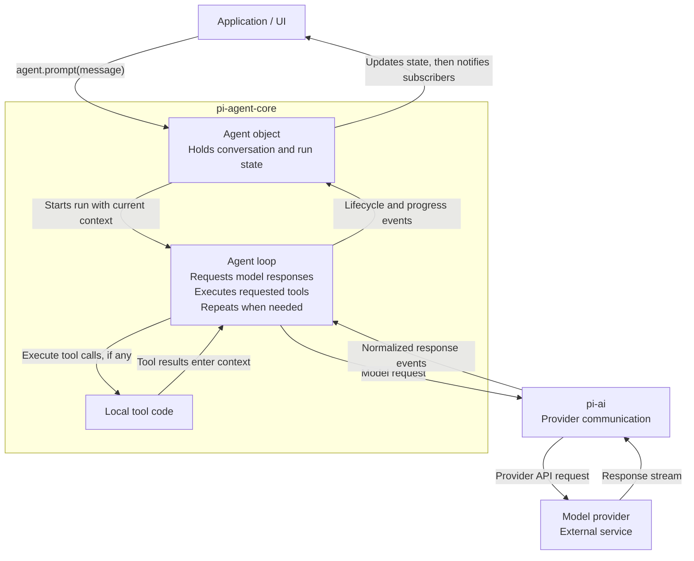

# Pi learning conversation transcript

This conversation took place in OMP before the learner moved to plain Pi to use the learning system at https://github.com/amosblomqvist/learn. The learner requested a transcript rather than an assessment, proposed questions, or a prescribed continuation. The messages below record the discussion from the request to learn Pi through the request for this handoff. Tool calls and their fetched source contents are omitted; links in the conversation identify the references. Assistant explanations are historical statements, not independently verified documentation or evidence that the learner mastered every point. No code examples were executed during this discussion.

## User

i wanna learn how pi works 
https://mariozechner.at/posts/2025-11-30-pi-coding-agent/
https://github.com/earendil-works/pi

aboce article by mario & the actual code are the references, I have read the articel

## Assistant

Let’s use **Mario’s article for the design rationale and the code for what actually happens**. You’ve read the article, so we won’t just repeat it.

One distinction: the article describes Pi in November 2025; the repository has evolved since then. We’ll flag differences rather than force today’s code to match the article.

I’d start by tracing **one prompt end to end**—then use that trace to understand the package boundaries, tools, context, sessions, and UI. Before choosing the depth:

**1. What’s your current model of tool calling?**  
Suppose you tell Pi:

> Read `package.json` and tell me the test command.

The model responds with a `read` tool call. Walk me through what you think happens next: **who executes the read, where its output goes, and what causes the model to respond again?** A rough guess is useful; “not sure” is too.

**2. What do you want to be able to do after learning this?**
- Navigate Pi’s code and explain its architecture.
- Build a small agent using Pi’s libraries.
- Customize Pi with extensions.
- Something else—or a combination.

Also mention your TypeScript/Node familiarity so the code explanations land at the right level.

## User

1. i dont have  super concrete take on tool calling , what i know - tool calling is essentially what agent does after receiving a question from user i.e. me , & then figures from the list of tools (basiclly piecies of code with defined input & output) which tool should be used to achieve current task, then it starts using those tools, what i read in the article was, tool calling results are of 2 types, which should be shown in ui, like file change, or command ran & result of it & 2nd type is for the model itslef. I know this much


2. i dont necesarily want to navigate pi's code, but i watware like pi does actually work, when i say this what i mean is i want to be familiar with it, im not able to explain exactly what i want, ok, lets go slow, how mario explains there are 4 fundamental libraries, right, now inside each lib i wannaw know what happens, wait still wrong way to epxplain what i want. 

2.1 i would like to understand at code level yes, but that would be a bti slower, so yes definetely some code level understanding, what call happens where hwo does it end. to take an example, lets consider 2 flows
2.1.1 i as a user fire up pi, what all happens then ? a flow chart of things ( now let me be supe clear, objective is not just to get a mermaid diagram of things, what matters is the granularity of the nodes in that chart, i should be aware if anything of meaning is happening)
2.1.2 other flow is, when i connect any provider , lets say chat gpt plus subscription , what all happens
2.1.3 when i type "hi" what all happens between me pressing enter & agent reverting with hi
2.1.4 all the other things, ocnsidered, assume i have a agents.md present in whichever dir im running pi in, or i have a bunch of skills configured at global level , what happens then during above flows, or i have plugins setup that listen to any of the step in above flow & inject some thing in pi (like i have a plugin which displays random fact while the response in loading from a list of 300 or so , its called impeccable, you can find it)
2.1.5 then this reminds, me there is whole plugin system of pi 


see im getting ahead of myself, but really i want to know how it works, first decently well, & then eventually really well

why ?

because i admire software like this. the internal workings of it, like in article when mario says 

"Finally, pi-ai provides an agent loop that handles the full orchestration: processing user messages, executing tool calls, feeding results back to the LLM, and repeating until the model produces a response without tool calls."

this is the part where , the agent actually appends all previous questions & answers to conetxt before making next call to llm right ? incrementally increasing the context

so i was not familiar to basics of how llm chat works till recently, so the fact that agent has to send back all of the previous chat, inclyding questions & asnwers & everything in between for every call is fasicnative to me

just saying, im familiar of how a llm chat like system works now


was i able to explain my expectation ?

basiclly  - understand how pi works, because its fucking cool, if im able to understand it, if im able to apprrecieate the decisions made to build it, then maybe i can build somethigng good ahead (not necesarily realted to pi, but in general)

## Assistant

**Yes—you explained it clearly.** You want a working mental model of Pi: what runs, what data moves, who owns that data, and why the pieces were designed that way. Enough code to make the explanation concrete, without turning it into a file-by-file tour.

The things you listed aren’t you getting ahead of yourself. They’re the questions we should eventually be able to answer.

### The level of detail you’re asking for

“Pi loads your configuration” would be too vague.

An explanation should instead establish:
- What configuration it discovers, and from where.
- What becomes instructions sent to the model versus settings used by Pi itself.
- When extensions get involved.
- What is held in memory versus saved.
- Which of those steps happens once at startup versus again for each model request.

We’ll expand a step when it introduces a meaningful mechanism—not just because there’s another function call underneath it.

### Your context observation is the right starting point

> The agent actually appends all previous questions & answers to context before making the next call to the LLM, right?

**Yes, in the ordinary conversation flow.** Pi retains the conversation and supplies the model-visible history on subsequent requests. That history includes more than your questions and the assistant’s prose: **a request to call a tool and the result of that tool are also part of the conversation.**

Two qualifications matter:

- It’s not necessarily *everything Pi knows*. UI-only information can stay out of the model’s input.
- It’s not necessarily the entire original history forever. Context can be transformed or compacted before a request.

The current [agent-core documentation](https://github.com/earendil-works/pi/blob/main/packages/agent/README.md#message-flow) explicitly distinguishes the agent’s internal messages from the messages prepared for the LLM.

There’s also one important boundary to sharpen in your tool-calling model:

**The model requests a tool call; Pi executes the code.** “The agent uses a tool” is convenient shorthand, but it hides those two separate actors. Understanding that boundary is what makes the loop stop feeling magical.

### How we’ll approach it

We’ll use your concrete scenarios as the backbone:

1. **Launch Pi:** what gets created and loaded before you type anything.
2. **Connect a provider:** how authentication gives Pi the ability to make requests.
3. **Type `hi`:** follow one request from Enter to the displayed reply.
4. **Ask something requiring a tool:** extend that same trace through execution and another model request.
5. **Add project instructions, skills, and extensions:** locate exactly where they enter those flows, including the loading-time fact display you mentioned.

The four libraries will become useful names for responsibilities we’ve already encountered—not four buckets of unfamiliar implementation details. We’ll keep Mario’s original rationale separate from changes in today’s code.

**Before we begin, one small question—not a terminology test:**

Suppose Pi calls `read` and successfully gets a file’s contents. **Why does it need another model request afterward, rather than just continuing the model request that asked for the file?**

Your current intuition is enough. This tells me whether to start with the lifetime of an individual model request or go straight into Pi’s startup.

## User

Why does it need another model request afterward, rather than just continuing the model request that asked for the file?

ok so , i dont know wht u mean by why does it need another model request afterward ?
does it ?

## Assistant

**Yes—in Pi’s ordinary tool-calling flow, it makes another request after executing the tool.** My question assumed a detail we hadn’t established yet.

The missing piece: **a model response can contain a request to run a tool instead of a final answer to you.** Pi receives that response, executes the requested code, then asks the model to continue with the result included.

For example, you ask: “What’s the test command in `package.json`?”

**First model request**

Pi sends the conversation, plus descriptions of the available tools. The model responds with something conceptually like:

```text
Call tool: read
Arguments: { "path": "package.json" }
```

That’s structured output from the model—not the model opening the file. **That model response finishes.**

**Local execution**

Pi runs the `read` tool’s code. It gets back the file contents. No model is needed to perform that filesystem operation.

**Second model request**

Pi sends the updated conversation, conceptually:

```text
User: What's the test command in package.json?
Assistant: Call read with {"path":"package.json"}
Tool result: {"scripts":{"test":"vitest run"}}
```

Now the model has information it didn’t have during the first request. It can respond:

```text
The test command is `vitest run`.
```

So **“the agent loop keeps running” does not mean “one model request stays running.”** Pi’s program keeps running across multiple model requests, with tool execution between them.

That’s the orchestration Mario means: Pi manages the cycle; the model generates each response. The [agent-core event flow](https://github.com/earendil-works/pi/blob/main/packages/agent/README.md#with-tool-calls) shows this as a tool-calling turn followed by another turn where the model responds to the result.

Does the distinction between **Pi continuing to run** and **an individual model response finishing** make sense?

## User

So “the agent loop keeps running” does not mean “one model request stays running.” Pi’s program keeps running across multiple model requests, with tool execution between them.

where did the terms "the agent loop keeps running" & "one model request stays running"

come from

i did not say one model request stasy running , how is that possible ? its just a api call in nut shell, it has to gfinisish , 
yes i understand pi makes multiple model calls in between tools after receing a question & responsding

## Assistant

Those were **my terms, not yours**. I introduced a hypothetical misconception, then explained it as though you held it. You didn’t.

Your “does it?” was asking whether Pi makes another request after a tool result. I should have answered directly instead of making assumptions about your understanding.

We’ve established:
- A model request is an API call that finishes.
- Pi executes tools between model calls.
- Subsequent calls include the relevant conversation and tool results.

**We’ll start with your first scenario: launching Pi.** We’ll trace what executes before the input prompt is ready, using the actual code, and introduce the library boundaries where they become relevant.

## User

see , this 1st 2nd & 3rd scenarios were just my suggestion on my expectation of learning this right ?

im fully onboard if we wanna go this way, but what if i hadnt said that, how would we have proceeded ?

## Assistant

Yes. **Those scenarios illustrated the depth and kind of understanding you want; they weren’t a prescribed syllabus.** I treated them too quickly as one.

Without those suggestions, I’d propose starting with **the smallest working agent**, then building outward until we can explain Pi:

1. **One model call.** What the program sends, what comes back, and what the program retains.
2. **Add one tool.** How a function is described to the model, how a tool-call response becomes an actual function invocation, and how its result enters the next request.
3. **Make it a loop.** What state persists across calls, what causes another iteration, and what ends the run.
4. **Turn it into a usable application.** Add provider authentication, saved sessions, instruction loading, terminal input, and streamed display—each in response to a concrete need.
5. **Make it extensible.** Understand where extensions can participate and what distinguishes executable extensions from skills and project instructions.

At each stage, we’d examine a small piece of real Pi code and explain the design choice it embodies. **The four libraries become the boundaries around these responsibilities**, rather than four directories we have to tour.

Why this order: startup involves wiring together many mechanisms. Following it first can tell you *what happens next* before you understand *what those mechanisms do*. Starting with a small working core gives the startup trace something to connect to.

Your scenarios would then become **checks on our understanding**: can we explain launching Pi, connecting a provider, sending `hi`, and adding an extension without hand-waving?

**My recommendation is core-first, then trace the full application.** Not because your scenarios were wrong—they’re excellent destinations—but because this gives us a more grounded route to them.

## User

ok lets go core first

## Assistant

We’ll start with **one model call using `pi-ai`**. No tools, agent loop, or terminal UI yet—just the part that communicates with a model.

## 1. The smallest useful piece

This is a reduced version of the current [`pi-ai` quick start](https://github.com/earendil-works/pi/blob/main/packages/ai/README.md#quick-start). It assumes an OpenAI API key is configured; subscription login is a separate mechanism we’ll cover later.

```typescript
import { builtinModels } from "@earendil-works/pi-ai/providers/all";

// Set up access to the supported providers.
const models = builtinModels();

// Look up the model we want to use.
const model = models.getModel("openai", "gpt-4o-mini")!;

// Build the input for this request.
const context = {
  systemPrompt: "You are a helpful assistant.",
  messages: [
    { role: "user" as const, content: "Hi", timestamp: Date.now() },
  ],
};

// Make one model request and wait for the completed response.
const response = await models.complete(model, context);

// Retain the response in our conversation.
context.messages.push(response);
```

There’s a TypeScript detail in that last line: the inferred `messages` array above accepts only user messages, so a runnable version should explicitly type `context` as Pi’s `Context`. The properly typed declaration is:

```typescript
import type { Context } from "@earendil-works/pi-ai";

const context: Context = {
  systemPrompt: "You are a helpful assistant.",
  messages: [
    { role: "user", content: "Hi", timestamp: Date.now() },
  ],
};
```

## 2. What each part actually does

### `builtinModels()` sets up the provider collection

A **provider** is Pi’s integration with a service such as OpenAI or Anthropic. It knows how to resolve authentication, which models it offers, and how to communicate with them.

`models` is the collection through which we access those providers. Creating it is setup—not asking an LLM a question.

### `getModel(...)` selects a model; it does not run it

The returned `model` is a description of the selected model, not an LLM loaded into your Node.js process.

The actual model runs at the provider. Pi needs the description to route the request appropriately.

### `context` is ordinary application data

Here it contains:
- A system instruction.
- One user message.

Nothing has been sent simply because we created this object. It lives in our program’s memory.

This is the first important ownership boundary: **our program holds the conversation it intends to send.**

### `complete(...)` is where we ask for a response

```typescript
const response = await models.complete(model, context);
```

The provider integration handles translating Pi’s representation into the provider’s API format and translating the returned output back into Pi’s representation.

That is the core job of **`pi-ai`: give the rest of the application a consistent interface despite differences between provider APIs.**

`response` is a structured assistant message, not just a string. For example, the quick start reads its content blocks, token usage, and cost information.

### `push(response)` retains the answer

```typescript
context.messages.push(response);
```

This line is separate from the request.

Receiving an answer and adding that answer to our stored conversation are **two distinct operations**. In this example, our code explicitly performs the second one. This only updates memory; it does not save a session to disk.

## 3. What we have—and don’t have

We have a program that can send one message and retain the answer.

We have **not** built an agent yet. There is no repeated execution, tool dispatch, or decision about whether another model call is needed. Those are responsibilities we’ll add on top.

One small check before that next step:

**After `context.messages.push(response)`, suppose we append a new user message, `"What did I just say?"`, and call `complete` again. What messages would that second request have available?**

## User

hi
assistant response
what did i just say

would contain these 3 mesages

## Assistant

Exactly. **Those three messages, in that order**, plus the system instruction supplied separately in `context`.

Now let’s add **one tool**. The interesting part is that making a function available to a model requires two different things:

1. **A description the model receives** so it can request the tool.
2. **Executable code in our program** that actually performs the operation.

## 2. Describing a tool is not implementing it

Suppose we want the model to retrieve the current time. Using Pi’s API, we can describe that capability like this:

```typescript
import { Type, type Tool } from "@earendil-works/pi-ai";

const getTimeTool: Tool = {
  name: "get_time",
  description: "Get the current time",
  parameters: Type.Object({}),
};
```

This object says:
- The tool’s name is `get_time`.
- Its purpose is getting the current time.
- Its arguments must be an object with no declared parameters.

`Type.Object({})` builds the input schema. **There is no implementation here.** Nothing in that object reads a clock.

We include the description in the request context:

```typescript
context.tools = [getTimeTool];
context.messages.push({
  role: "user",
  content: "What time is it?",
  timestamp: Date.now(),
});

const response = await models.complete(model, context);
context.messages.push(response);
```

The model receives the conversation **and the tool description**. It does not receive our executable function.

## What comes back?

Instead of only producing text, the model can return a structured content block requesting the tool:

```typescript
// Illustrative response.content:
[
  {
    type: "toolCall",
    id: "call_123",
    name: "get_time",
    arguments: {},
  },
]
```

The model has generated **the name of an operation and its arguments**. It has not executed anything.

Our program inspects the response and dispatches the requested operation:

```typescript
for (const block of response.content) {
  if (block.type === "toolCall" && block.name === "get_time") {
    const time = new Date().toISOString();

    context.messages.push({
      role: "toolResult",
      toolCallId: block.id,
      toolName: block.name,
      content: [{ type: "text", text: time }],
      isError: false,
      timestamp: Date.now(),
    });
  }
}
```

Here, **`new Date().toISOString()` is the actual tool implementation**. Our Node.js process executes it.

Notice `toolCallId`: it links this result to the particular call the model requested. That matters when a response requests multiple tools—even multiple calls to the same tool.

After executing the tool, we make the next request:

```typescript
const answer = await models.complete(model, context);
context.messages.push(answer);
```

The model can now use the returned time to write its answer.

### The design boundary

**`pi-ai` represents tool descriptions, tool-call responses, and tool-result messages—but in this example, our application supplies the execution logic.** Registering a description does not make `complete()` execute a function automatically.

That separation is why the same model API can support a clock tool, a file reader, or a database query without knowing how any of them work.

This follows the repository’s [tool-calling example](https://github.com/earendil-works/pi/blob/main/packages/ai/README.md#quick-start). Next, we’ll look at how `pi-agent-core` takes over the manual dispatch-and-repeat work we just wrote.

## User

ok

## Assistant

Now we have a small design problem: **our previous code handles one round of tool calls, but the model might need another tool afterward.** We don’t want to manually write a second round, a third round, and so on.

That is where the **agent loop** comes in.

## 3. Turn the sequence into a loop

Strip away streaming, error handling, and customization hooks for a moment. The basic algorithm is:

```typescript
// Teaching pseudocode—not copied Pi source.

while (true) {
  const response = await callModel(context);
  context.messages.push(response);

  const toolCalls = response.content.filter(
    block => block.type === "toolCall"
  );

  if (toolCalls.length === 0) {
    break;
  }

  for (const call of toolCalls) {
    const result = await executeTool(call);
    context.messages.push(result);
  }
}
```

There are three meaningful decisions here.

### 1. Keep the model’s response—even when it requests tools

```typescript
context.messages.push(response);
```

A tool-call response is part of the conversation, not a disposable instruction to our program. The next request includes **what the model requested and what the tool returned**.

### 2. Execute the requested tools, then let the model decide what comes next

After appending the results, execution reaches the top of the loop again.

Our program does **not** need to decide in advance:

> “Read the file, then run a command, then explain the output.”

The model can request the next operation based on the latest results. The loop supplies the execution machinery.

### 3. No tool calls means the ordinary loop can stop

The response might simply contain:

> “Your test command is `vitest run`.”

That response has already been retained. With no tools to execute, there’s nothing else for this basic loop to do.

**The stopping condition is not “the model said the word ‘done.’” It is the structure of the response: no tool calls.**

## Where this lives in Pi

In the current [`packages/agent/src/agent-loop.ts`](https://github.com/earendil-works/pi/blob/main/packages/agent/src/agent-loop.ts), the internal `runLoop()` function contains this core sequence:

- Call `streamAssistantResponse(...)`.
- Extract content blocks whose type is `"toolCall"`.
- Execute them through `executeToolCalls(...)`.
- Append the tool-result messages to the current context.
- Continue when needed.

The real implementation also handles cancellation, failures, queued user input, events, and hooks that can alter continuation. Those add branches to this basic mechanism; we’ll unpack them when they matter.

**So our first library boundary is now concrete:**

- **`pi-ai`** provides the interface for communicating with models.
- **`pi-agent-core`** adds the orchestration: call the model, execute requested tools, update the conversation, and repeat.

One useful consequence: **a tool result can influence the next action without our program knowing what that action will be in advance.** That’s what this loop buys us over a fixed sequence of API calls.

## User

understood, distinction clear between pi ai & pi agent core

essentially a loop for each hi (user message) sent to pi

## Assistant

Yes—**for a normal user message, Pi starts an agent run that may make one or several model calls.**

- **`hi`** → model replies with text → run ends after one call.
- **“Find and fix this bug”** → model requests tools → Pi executes them → model sees results → possibly more tools → final reply → run ends.

The **conversation survives between runs**. When you send the next message, Pi adds it to the existing conversation and starts another run.

So we now have three distinct things:

| Thing | Lifetime |
|---|---|
| **Model request** | One API interaction with the provider |
| **Agent run** | Processing your message, potentially across multiple model requests and tool executions |
| **Conversation state** | Retained across your successive messages |

That leads to the next piece: **who holds the conversation between runs?** In `pi-agent-core`, the `Agent` class is the stateful object around the loop. The loop does the work for a run; the `Agent` holds state and provides methods such as `prompt(...)` to start that work.

## User

Okay, so we are talking about who holds the conversation state. Okay, bas till now I have understood that the in the above conversations this context object which we create right this context dot messages here is the state maintained right that is what I understand let's go ahead what you want me to

## Assistant

Yes. **In our hand-written example, `context.messages` is where we maintain the conversation.** Your understanding is right.

When we use Pi’s `Agent` class, we hand that bookkeeping over to an object.

## From managing context ourselves to using `Agent`

Previously, our code was responsible for:

```typescript
// Our responsibility:
context.messages.push(userMessage);
// Run the loop.
// Retain assistant messages and tool results.
```

With `Agent`, the application can instead do this:

```typescript
const agent = new Agent({
  initialState: { model },
  streamFn: models.streamSimple.bind(models),
});

await agent.prompt("Hi");
await agent.prompt("What did I just say?");
```

These are successive calls on **the same `agent` object**. Its conversation is accessible through:

```typescript
agent.state.messages
```

The second `prompt()` uses the history accumulated during the first. We no longer manually append each assistant response and tool result.

`streamFn` supplies the model-calling function the agent loop will use. Here it connects the agent to our `pi-ai` provider collection.

## How does `Agent` retain what happens inside the loop?

There’s a useful mechanism in the [actual implementation](https://github.com/earendil-works/pi/blob/main/packages/agent/src/agent.ts): **the loop reports events, and `Agent` updates its state from those events.**

For example, when a message finishes, the loop emits a `message_end` event. The `Agent` handles it with this code:

```typescript
case "message_end":
  this._state.streamingMessage = undefined;
  this._state.messages.push(event.message);
  break;
```

That handles completed user messages, assistant messages, and tool-result messages.

During generation, `message_update` events update a separate field:

```typescript
case "message_update":
  this._state.streamingMessage = event.message;
  break;
```

So it distinguishes:

- **The completed conversation:** `state.messages`.
- **The response currently arriving:** `state.streamingMessage`.

This lets the program display a growing response without appending a new conversation message for every arriving chunk.

## Why wrap the loop in an object?

The loop handles **one run**. The `Agent` is the longer-lived object that holds the conversation and tracks whether a run is active.

That gives the surrounding application a convenient interface:

> “Here is another user message. Process it using the state you already hold.”

One boundary remains important: **this is in-memory state, not saved session storage.** Holding onto the same `Agent` preserves the conversation across prompts; preserving it after the process exits requires another layer.

Next we can follow the events outward: the same events that keep `Agent`’s state updated also let a UI show text and tool activity as they happen.

## User

ok

## Assistant

## 4. How does the UI know what the agent is doing?

A model request can take several seconds. Waiting until `agent.prompt(...)` finishes would mean showing nothing until the entire run—including any tools—is over.

Instead, **the agent reports events as work happens.** The surrounding application subscribes to them.

Here is the pattern from Pi’s [agent-core quick start](https://github.com/earendil-works/pi/blob/main/packages/agent/README.md#quick-start):

```typescript
agent.subscribe((event) => {
  if (
    event.type === "message_update" &&
    event.assistantMessageEvent.type === "text_delta"
  ) {
    process.stdout.write(event.assistantMessageEvent.delta);
  }
});

await agent.prompt("Hi");
```

`subscribe(...)` registers a callback. During the run, the agent calls that callback with events describing its progress.

`text_delta` means **a newly arrived piece of text**, not the complete answer so far. Writing each delta makes the answer appear progressively.

### There are two levels of events here

**`pi-ai` reports what happens during a model response:**

- Text arrives.
- Reasoning content arrives, if exposed by the provider.
- Tool-call arguments arrive.
- The response finishes or fails.

It translates provider-specific streaming formats into Pi’s common event format.

**`pi-agent-core` reports the larger execution lifecycle:**

- An agent run starts.
- A message starts, updates, or finishes.
- A tool starts executing, reports progress, or finishes.
- The agent run ends.

That second level is necessary because **the model provider cannot report the execution of our local tools**. It only generated the requests to call them; Pi executes them afterward.

### The UI is a listener—not the driver of the loop

For example, an application could react like this:

| Agent event | Possible UI action |
|---|---|
| `message_update` containing a text delta | Display the arriving text |
| `tool_execution_start` | Show the tool name and arguments |
| `tool_execution_update` | Refresh the tool’s progress display |
| `tool_execution_end` | Show the completed result |

Those display choices belong to the application. **The agent core emits events; it does not need to know how to draw a terminal.**

This is a useful design decision: the same core can sit underneath a terminal UI, a web UI, or a program that simply records events. Changing the presentation doesn’t require rewriting tool execution or the model-call loop.

And it connects to the previous step: inside `Agent`, Pi first updates its own state from an event, then notifies subscribers. A listener can therefore inspect state that already reflects that event.

**We now have the central pieces:** `pi-ai` communicates with the model; the agent loop orchestrates work; `Agent` retains state; subscribers observe progress. A terminal interface is one consumer of those events—not what makes the agent work.

## User

Okay, let me stop you here for a bit. We are inside learning system, right? So, which phase are in me of learning system? Usually from what I read, it understands what I know and then it starts teaching, right? Using a bunch of skills it has, like drawing mermaid diagrams and all. So, are we still in that loop, or have we digressed away from that

## Assistant

**We’ve been teaching, but we haven’t been following that repo’s full learning process.** You’re right to flag it.

Also, reading the learning-system repository did **not** install or activate it here. I read its teaching instructions and adopted parts of the approach, but I should have made that distinction explicit.

Its prescribed phases are:

| Phase | What it requires | What we actually did |
|---|---|---|
| **Probe** | Establish your goal and find the boundaries of your understanding across relevant prerequisites | Clarified your goal, but only checked a few concepts—not a complete probe |
| **Plan** | Present an approach and a dependency diagram, then wait for approval | Proposed a core-first sequence; you approved it, but I omitted the dependency map |
| **Teach** | For each concept: motivate, establish, connect, and quiz-check before building further | Explained concepts incrementally, but mostly treated “ok” as enough to advance |

**So we’re effectively in Phase 3, having incompletely done Phases 1 and 2.** The biggest departure isn’t the lack of diagrams—it’s that I kept introducing new concepts without checking whether you could reason with the previous ones.

Mermaid/SVG skills are supporting tools, not what defines the teaching loop. Nor have research or visualization subagents from that repository been running here; I’ve been reading Pi’s sources directly.

We don’t need to discard what we covered. **The repair is to pause new material, check the foundations we’ve introduced, and then agree on the dependency map before continuing.**

Start with this concrete situation:

> Pi is halfway through displaying a model’s response. You close the terminal and the Pi process exits.

Based only on what we’ve covered, **what conversation data have we established would survive that exit—and what additional mechanism would be needed to resume later?**

“I don’t know yet” is useful here; this is checking the boundary, not grading your memory.

## User

Some concepts which you introduced like how PyAI works, it is pretty clear where PyAgent Core comes, and it is also clear, and then where this state management comes in, where I agent core maintains state in line, right? And then, when you started explaining these events to me, how does the UI know what the agent is doing? So, till here, if you could visualize, that would be good. Just so you know, we are inside OMP running inside a terminal. I think the repo is built for Pi and not OMP. We are inside a VPS, so any MD file you create, I'll have to operate open separately in Oxidian. So, tell me if you know if anything which is specific to you teaching me, just let me know and we'll get it figured out

## Assistant

**We can keep the visuals directly in this chat—no Markdown files or Obsidian needed for this explanation.** OMP supports Mermaid diagrams rendered as terminal-friendly diagrams.

We’re studying **Pi’s architecture**, not claiming these are OMP’s internals. The Pi learning repo’s custom quiz popups, Markdown logger, and visualization agents aren’t active here. I can still explain, draw diagrams, ask questions, and check Pi’s source using the tools available here.

## The pieces we’ve covered



**The important separation:** the downward path starts work; the events coming back let the application observe that work. The UI doesn’t have to keep asking, “Are you done yet?”

## Zoom in: a response arriving

For a text-only response, with no tools:

```mermaid
sequenceDiagram
    participant UI as Application / UI
    participant Agent as Agent
    participant Loop as Agent loop
    participant AI as pi-ai
    participant Provider as Model provider

    UI->>Agent: prompt("Hi")
    Agent->>Loop: Start run with current conversation
    Loop->>AI: Request model response
    AI->>Provider: Send provider-formatted request

    loop As text arrives
        Provider-->>AI: Provider stream chunk
        AI-->>Loop: Normalized text event
        Loop-->>Agent: message_update
        Note over Agent: Update streamingMessage
        Agent-->>UI: Notify subscriber
        Note over UI: Display arriving text
    end

    Provider-->>AI: Response finishes
    AI-->>Loop: Completed assistant response
    Loop-->>Agent: message_end
    Note over Agent: Append completed message to messages
    Agent-->>UI: Notify subscriber
    Loop-->>Agent: agent_end
    Note over Agent: After listeners finish, mark run idle
```

An **event** here is just a structured JavaScript object passed to a callback—not a separate service or background process. For example:

```typescript
{
  type: "message_update",
  // Updated message and details of what arrived...
}
```

`Agent` handles that object to update its state, then passes it to registered listeners. A UI listener can display text; another listener could record activity.

**One distinction to keep from this picture:** `streamingMessage` holds the response currently arriving; `messages` holds completed conversation messages. Both are in memory at this layer. Saving them to disk is something we haven’t covered yet.

Sources: Pi’s [`Agent` implementation](https://github.com/earendil-works/pi/blob/main/packages/agent/src/agent.ts) and [agent loop](https://github.com/earendil-works/pi/blob/main/packages/agent/src/agent-loop.ts).

Does this give you a clearer picture of **where events originate and how they reach the UI**, or is one arrow still hiding a mechanism you want unpacked?

## User

I actually want to continue learning or rather start learning from scratch in plain Pi and not OMP and actually use how that learning system was intended to work but again I don't want to start from scratch there could could you prepare a MD file or something of whatever the progress we have made here so my new learning agent knows what I have spent last one hour learning or rather studying or rather whatever we are doing

## User

I would prefer that you in this handoff document do not bias the learning system as to what the potential questions could be instead just you know give the context that this is how the user started his journey and this is the transcript I feel transcript would be the most appropriate way to hand it off would it or I don't want to bias it I want to let it teach how it wants to with the given context that user had had this much context to study
